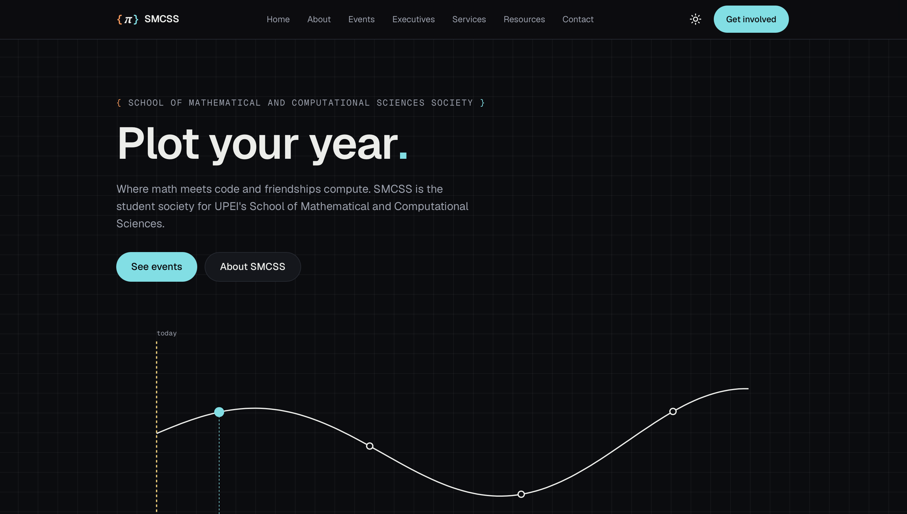
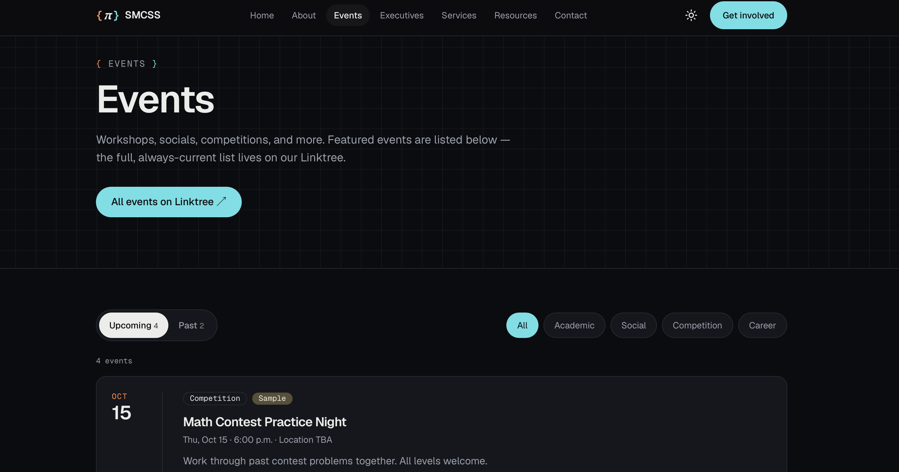
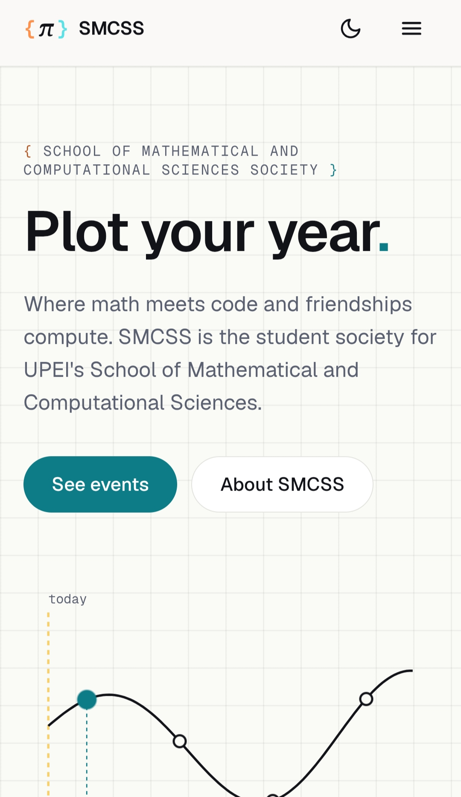
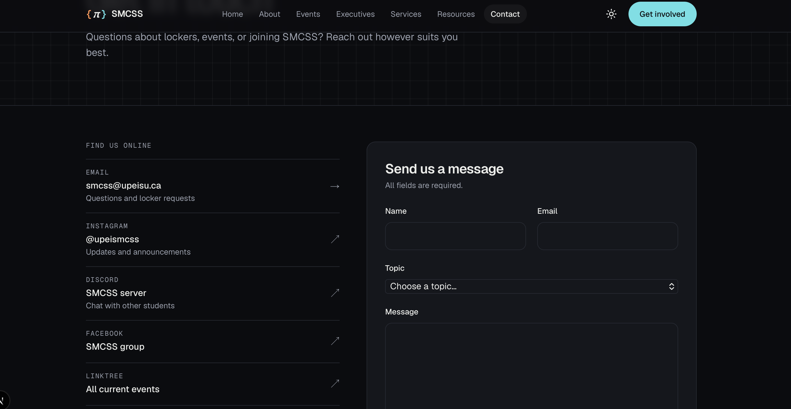

# SMCSS Website

The official website for the **School of Mathematical and Computational Sciences Society (SMCSS)** at the University of Prince Edward Island.

**Live site:** https://smcs-website-one.vercel.app

Built for the **2026 SMCSS AI Website Building Competition**, where the winning site becomes the society's real website on its own domain.

---

## Contents

1. [Overview](#overview)
2. [Competition context](#competition-context)
3. [Features](#features)
4. [Screenshots](#screenshots)
5. [Tech stack](#tech-stack)
6. [Run it locally](#run-it-locally)
7. [Commands](#commands)
8. [Project structure](#project-structure)
9. [Editing content (for SMCSS executives)](#editing-content-for-smcss-executives)
10. [Deployment](#deployment)
11. [Connecting the Squarespace domain](#connecting-the-squarespace-domain)
12. [Accessibility](#accessibility)
13. [Performance](#performance)
14. [Security](#security)
15. [Handoff checklist](#handoff-checklist)
16. [Future improvements](#future-improvements)
17. [Credits](#credits)

---

## Overview

The site gives SMCS students one place to find:

- events
- locker rental
- academic resources
- the executive team
- ways to get involved

It was designed around two ideas:

- **Useful in five minutes, memorable in ten seconds.** The home page opens with an interactive plot of upcoming events, and every page leads to something a student can actually do.
- **Easy for future executives to maintain.** Content lives in simple data files, so adding an event or a resource never means touching page layouts.

The visual identity comes from the SMCSS logo. The orange and cyan `{ }` braces work as both set notation and code blocks, and appear throughout the site. The graph-paper grid and plotted curve nod to mathematics without relying on clichés.

## Competition context

The brief's required pages and how this site covers them:

| Required page | What's on it |
|---|---|
| **Home** | What SMCSS is, who it serves, upcoming events (interactive plot), lockers, resources, get involved |
| **About** | Mission and purpose, the society's official objectives, society information, membership sign-up |
| **Events** | Upcoming and past events, category filters, registration links, add-to-calendar |
| **Executives** | Current team with roles, photos, and bios; graceful placeholders until the team is confirmed |
| **Services** | Locker rental: price, deposit, location, steps, rules, FAQ, and a pre-filled request email |
| **Resources** | Searchable, filterable academic resources, course tools, student opportunities, and useful links |
| **Contact** | Email, Instagram, Discord, Facebook, Linktree, location, and a validated contact form |

Judging categories this was built against: UI/Visual Design, UX/Usability, Functionality, Creativity/Innovation, Mobile/Accessibility, and People's Choice.

## Features

**Home page event plot.**
- Upcoming events appear as points on a curve over a time axis, with a "today" marker.
- Hover, tap, or Tab to a point to see the event. The ‹ › buttons step through events.
- It's built with plain SVG and HTML, with no chart library.

**Events system.**
- Events are typed objects in one file.
- Finished events move to "Past" automatically, because the site re-checks every hour. Nobody has to delete them.
- Filter by category.
- **Add to calendar** with a Google Calendar link or an `.ics` download for Apple Calendar and Outlook. All times are handled in Atlantic Time.

**Resources search.**
- Instant search across titles, descriptions, and categories, combined with category filters.

**Locker rental.**
- Official pricing, steps, rules, and an FAQ.
- The "Email to rent a locker" button opens a ready-made email, so students only add their name.

**Contact form.**
- Validation with clear, accessible error messages, and a success state.
- Spam protection: a honeypot field, a minimum time-to-submit check, and Formspree's own filtering.

**Light and dark mode.**
- Follows the system setting by default. There's a manual toggle in the navbar, and the choice is remembered with no flash on load.

**Polish.**
- A social preview image, generated automatically, for links shared on Instagram, Discord, or iMessage.
- A favicon from the SMCSS logo, plus a sitemap, robots.txt, and a custom 404 page.

## Screenshots


| Home | Events |
|---|---|
|  |  |

| Mobile menu | Dark mode |
|---|---|
|  |  |

**Lighthouse (PageSpeed Insights):** 100 Performance · 100 Accessibility · 100 Best Practices · 100 SEO, on both mobile and desktop.

## Tech stack

| Tool | Why |
|---|---|
| [Next.js](https://nextjs.org/) (App Router) | Pages are pre-rendered for speed; built-in image, font, and SEO tools |
| TypeScript | Catches mistakes in content files (e.g. a misspelled event category) before they break the site |
| [Tailwind CSS](https://tailwindcss.com/) v4 | Consistent spacing and colours from one set of design tokens |
| [Vercel](https://vercel.com/) | Free hosting; every push to `main` deploys automatically |
| [Formspree](https://formspree.io/) | Contact form delivery with no server code or secret keys |

There are no UI or animation libraries. Interactivity is limited to the few components that need it.

## Run it locally

You need [Node.js](https://nodejs.org/) 20 or newer and Git.

```bash
git clone https://github.com/rupi-upei/smcs-website.git
cd smcs-website
npm install
cp .env.example .env.local   # then add your Formspree form ID
npm run dev
```

Open http://localhost:3000.

## Commands

| Command | What it does |
|---|---|
| `npm run dev` | Start the development server, which reloads as you edit |
| `npm run build` | Build the production version (run this to check for errors before pushing) |
| `npm run start` | Run the production build locally |
| `npm run lint` | Check the code for common problems |

## Project structure

```
app/                     Pages (each folder = a URL)
  page.tsx               Home
  about/ events/ executives/ services/ resources/ contact/
  layout.tsx             Wraps every page: fonts, navbar, footer, metadata
  globals.css            Design tokens (colours), grid texture, animations
  not-found.tsx          404 page
  opengraph-image.tsx    Social preview image
  sitemap.ts, robots.ts  SEO
components/              Reusable building blocks (cards, navbar, form, ...)
  home/                  Home page sections
data/                    ← CONTENT LIVES HERE (edit these)
  events.ts
  executives.ts
  resources.ts
  services.ts
lib/                     Helpers
  site.ts                ← Contact details, social links, navigation
  types.ts               The shape of an event, resource, executive
  events.ts, plot.ts, calendar.ts
public/                  Images (logo, executive photos)
```

## Editing content (for SMCSS executives)

You don't need to know React. All regular updates happen in a few files.

**The easiest way:**
1. Open the file on GitHub.
2. Click the ✏️ pencil icon.
3. Make your change.
4. Click **Commit changes**.

Vercel updates the live site in about a minute.

> **Tip:** copy an existing entry and change its values. Keep the commas and quotes exactly as they are. If something is wrong, TypeScript stops the deploy and the old version stays live, so you can't break the site by accident.

### Add an event: `data/events.ts`

```ts
{
  id: "python-workshop-nov-2026",          // unique, lowercase-with-dashes
  title: "Python Workshop",
  start: "2026-11-12T17:30:00-04:00",      // -03:00 before Nov 1, -04:00 Nov–mid-March
  location: "Cass Science Hall, Room 202",
  category: "Workshop",                    // Academic | Social | Competition | Career | Workshop | Community
  description: "A hands-on intro to Python for beginners.",
  link: "https://forms.gle/...",           // optional: registration link
},
```

- **Removing finished events is optional.** They move to "Past" on their own.
- The full, always-current event list lives on the society's [Linktree](https://linktr.ee/upeismcss). This file is for events you want to feature on the site.
- **Delete the sample events** (they're marked `placeholder: true`) once real ones are added.

### Update the executive team: `data/executives.ts`

```ts
{
  role: "President",
  name: "Jane Doe",
  program: "BSc Computer Science, 3rd year",
  bio: "Short, friendly intro.",
  photo: "/executives/jane.jpg",           // optional: put the image in public/executives/
  email: "president@example.com",          // optional
},
```

Without a photo, the card shows the person's initials. The "team will be announced soon" notice disappears once any name is added. Only publish photos with each person's permission.

### Add a resource: `data/resources.ts`

```ts
{
  title: "Desmos",
  description: "Free online graphing calculator.",
  url: "https://www.desmos.com/calculator",
  category: "Math",                        // see the category list at the top of the file
  featured: true,                          // optional: also show on the home page
},
```

### Change locker details: `data/services.ts`

Edit the price, deposit, location, steps, rules, or FAQ.

### Change contact details or social links: `lib/site.ts`

The email, Instagram, Discord, Facebook, Linktree, the membership form link, and the navigation are all set here.

### Why it's built this way (and how to grow it)

Pages never contain content directly. They ask small helper functions for it (e.g. `getUpcomingEvents()` in `lib/events.ts`), and those functions read the data files.

To move to a CMS later (e.g. **Sanity**, **Contentful**, or **Supabase**), you would only change those helper functions to fetch from the CMS instead of the file. The pages and components stay the same, because `lib/types.ts` already defines the shape of each item.

## Deployment

The site is hosted on **Vercel**, connected to this GitHub repository.

- Every push to `main` deploys to production automatically.
- **Environment variables** (Vercel → Project → Settings → Environment Variables):

| Variable | Purpose |
|---|---|
| `NEXT_PUBLIC_FORMSPREE_ID` | The Formspree form ID that receives contact form messages |
| `NEXT_PUBLIC_SITE_URL` | The site's public address, used for sharing previews and the sitemap (e.g. `https://upeismcss.ca`) |

After changing a variable, redeploy: **Deployments** → **⋯** → **Redeploy**.

> **Note for contributors:** Vercel's free plan only deploys commits whose Git author email matches a GitHub account linked to the project. Set `git config --global user.email` to your GitHub email.

## Connecting the Squarespace domain

The society's domain, **upeismcss.ca**, is currently managed through Squarespace. There are two very different things "Squarespace" can mean:

| | Squarespace-hosted website | Domain managed by Squarespace, site hosted elsewhere |
|---|---|---|
| Where the site's code runs | Squarespace's servers, built with Squarespace's editor | Vercel |
| Can it run this Next.js site? | **No.** Squarespace can't host custom Next.js apps | **Yes**, this is the intended setup |
| What Squarespace does | Everything | Keeps the domain registration and DNS settings only |

This project uses the **second** option, which the competition organizers confirmed is acceptable. Squarespace keeps the domain. Its DNS settings simply point visitors to Vercel.

### Recommended: point the domain to Vercel via DNS

1. **Add the domain in Vercel.** Project → **Settings** → **Domains** → add `upeismcss.ca` (and `www.upeismcss.ca`). Vercel then shows the exact DNS records it needs, usually an **A record** for the root domain and a **CNAME record** for `www`. **Always use the values Vercel shows at that moment**, rather than copying them from a guide.
2. **Before changing anything in Squarespace, write down the existing DNS records**, especially any **MX** (email) and **TXT** records. If the society uses email on this domain, those records must stay, or email will stop working.
3. **Add or update the records in Squarespace.** Open the domain's **DNS settings** in Squarespace and edit the custom records to match what Vercel asked for. Remove any old records that conflict (e.g. an old A record for `@` pointing somewhere else). Squarespace's help centre has a guide titled "Adding custom DNS records to your Squarespace domain."
4. **Wait.** DNS changes usually take minutes, but can take up to 48 hours. Vercel shows a ✅ next to the domain when it's working, and issues an HTTPS certificate automatically.
5. **Update the site URL.** Set `NEXT_PUBLIC_SITE_URL` to `https://upeismcss.ca` in Vercel and redeploy.

> **Important:** `upeismcss.ca` currently serves the society's existing website. Changing the DNS replaces it. Only do this at handoff, with the society's go-ahead.

### Other options (and why they're not recommended)

- **Subdomain first** (e.g. `new.upeismcss.ca`): add one CNAME record for the subdomain pointing to Vercel. This is a low-risk way to preview the new site on the real domain before switching the main address.
- **Vercel nameservers:** the domain's nameservers could be pointed to Vercel, so all DNS is managed in Vercel. It works, but it moves every DNS record (including email) to a new place. That's more risk for no real benefit here.
- **Embedding in a Squarespace page** (iframe or code injection): technically possible on some Squarespace plans, but the site would sit inside another page. That breaks mobile scrolling, sharing previews, and search visibility. **Not recommended.**
- **Transferring the domain away from Squarespace:** possible, but unnecessary. DNS pointing already gives the society full use of the domain.

## Accessibility

Built to WCAG 2.2 AA good practice:

- **Structure:** semantic HTML (landmarks, a correct heading order, lists, `<dl>` for facts) and a "Skip to content" link.
- **Keyboard:** everything works by keyboard, including the event plot points, filters, FAQ, mobile menu (`Esc` closes it), and form. Focus rings are clearly visible.
- **Colour:** all text meets AA contrast in both themes. The logo's bright brand colours are used for decoration only in light mode, with deeper text-safe versions for text.
- **Touch targets:** at least 44×44 px.
- **Forms:** real labels, `aria-invalid`, errors linked to their fields, focus moved to the first error, and success and error states announced.
- **Screen readers:** live regions announce filter result counts. External links say "opens in a new tab," and decorative graphics are hidden.
- **Motion:** respects **Reduce motion**. All animations are disabled for users who turn it on.

## Performance

- **Lighthouse: 100 / 100 / 100 / 100** on mobile and desktop.
- Pages are pre-rendered and refreshed hourly (incremental static regeneration), so most visitors get a ready-made page.
- Only interactive pieces (the plot, filters, form, menu, and theme toggle) send JavaScript to the browser.
- There are no chart, animation, or icon libraries, so the hero is lightweight SVG.
- Fonts are self-hosted through `next/font`, with no layout shift.
- Hero images are avoided entirely, so nothing large has to load first.

## Security

- No secrets are committed. `.env.local` is git-ignored, and `.env.example` lists the variables with placeholder values.
- The Formspree form ID is public by design (it's visible in any site's form), so it's safe in client code.
- External links use `rel="noopener noreferrer"`.

## Handoff checklist

From the competition brief, if this entry wins:

- [ ] Transfer this GitHub repository to the SMCS organization (Settings → Transfer ownership)
- [ ] Transfer the Vercel project to the SMCS team account
- [ ] Create an SMCSS-owned Formspree form and update `NEXT_PUBLIC_FORMSPREE_ID` in Vercel
- [ ] Connect `upeismcss.ca` via Squarespace DNS ([steps above](#connecting-the-squarespace-domain)) and set `NEXT_PUBLIC_SITE_URL`
- [ ] Replace placeholder content (sample events, executive team, payment details for lockers)
- [ ] Full production test pass: desktop, mobile, and every page

## Future improvements

- A CMS (e.g. Sanity or Supabase) so executives can edit content in a web dashboard
- Pulling events automatically from the society's Linktree or a shared calendar feed
- An online locker request and availability system
- An archive of past events with photos
- French translation

## Credits

- **Design and development:** Rupinder Singh, for the 2026 SMCSS AI Website Building Competition. Built with help from AI (Anthropic's Claude), which the competition rules allow.
- **Logo, name, and official content** (objectives, locker details, contact information): © SMCSS, UPEI.
- **Fonts:** Geist and Geist Mono by Vercel.
